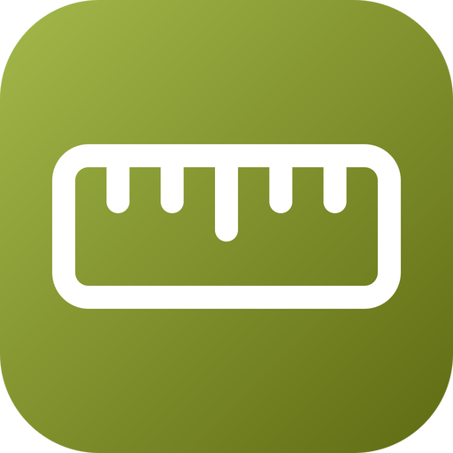

# go-units — brand assets

Official logos for the **go-units** organization.

The mark is the instrument that stands for measuring: a ruler, with a long
graduation at the middle and short ones between. It is written by
`mark/main.go`, which derives the pitch and the length of every graduation from
the size of the ruler and centres the drawing; nothing is placed by hand. Its
gradient (`#A3B84A` to `#5F6B12`) is an olive that sets go-units apart from the
violet of go-numerics, the emerald of go-ndarray and go-fft, the blue of
go-plot, the magenta of go-bignum, the coral of go-sparse, the orange of
go-approx and the rose of go-dsp; its dark end reads on white at 5.84:1 and its
light end on a dark page at 8.75:1.

## Formats

- **SVG** — `svg/color`, `svg/white` (white, transparent), `svg/black` (black, transparent)
- **PNG** 16→1024 px, 3 variants — `png/<variant>/<size>/`
- **JPG** (color, white background) — `jpg/<size>/`
- **ICO** (Windows) — `ico/`
- **ICNS** (macOS) — `icns/`
- **GitHub avatar** 512 px — `avatar/`
- **Social preview** 1280×640 (repo banner) — `social/`

`check/kit.py` counts the whole matrix on every pull request, and the `mark`
job runs `mark/main.go` again and fails if `svg/color/go-units.svg` differs.

---
*Generated from `svg/color/go-units.svg` by the fleet's Go brand pipeline (brandgen) — rounded square badge, line glyph, color / white / black variants.*
